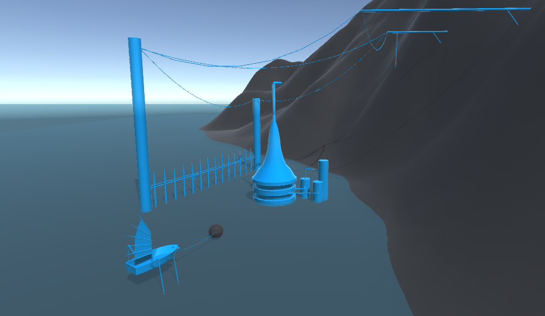
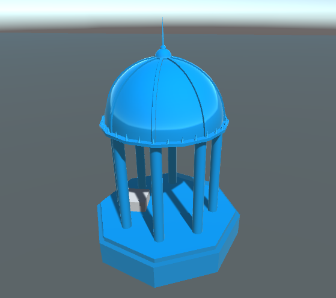
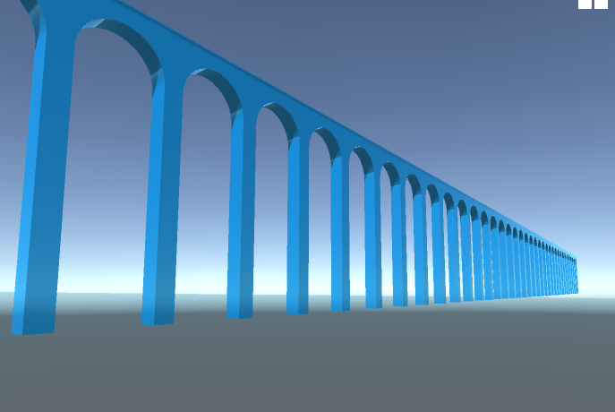
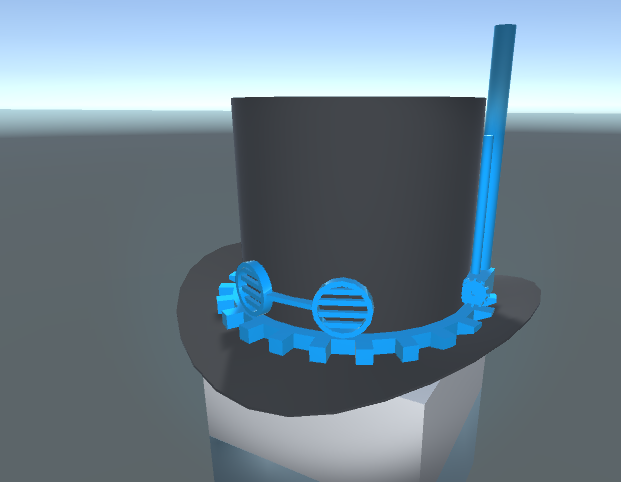
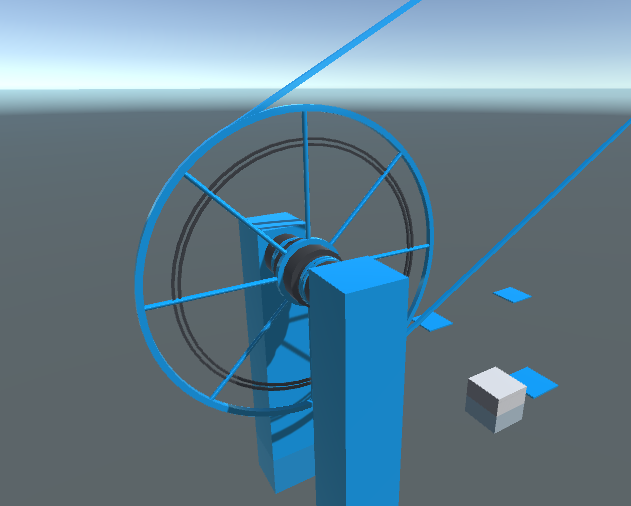
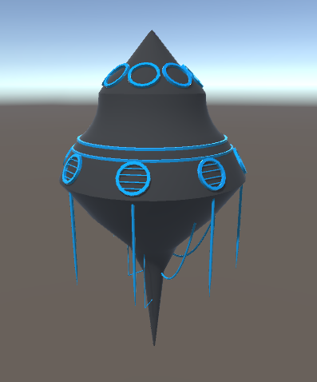
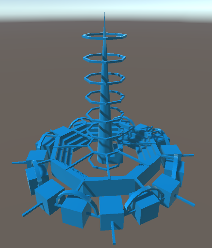
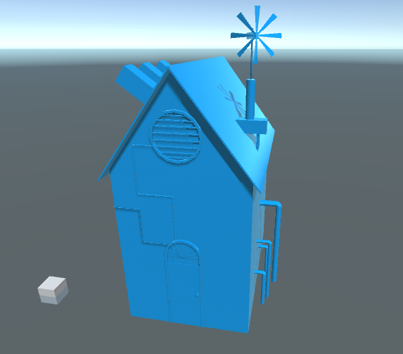

# ModelingEngineShowcase
Collection of images etc from a modeling engine I worked on some time ago.  
See youtube links for demos:  
[General Test](https://www.youtube.com/watch?v=UpHQmqVDMCE)  
[Voxel Terrain test](https://www.youtube.com/watch?v=Pjq79ml25q4)  

Or look bellow for various images.
# Various Objects
  
  
  
  
  
  
  
  

# Additional Info
The engine was mostly built on unity for it's rendering.  
Apart from that, most of it was hand-written.  
Some interesting aspects are listed here.
## Generator-based system
The engine was built on the idea of many pre-defined "generators" that would make various shapes.  
These ranged from simple cylinders, to things like stairs, to terrain systems or "lathe" tools.  
The intuition is that if I can visually imagine a shape that is really just a small set of parameters (like say how big the stairs should be, and how many steps they should have), then the engine should have a generator for it.
## Scene System
Scenes were split into chunks, and only loaded the objects around the viewer.  
The general idea was that I wanted to have a modeling engine that felt similar to an open-world game, where you could just fly around modeling out an infinite level.  
(early versions didn't have this, but I ended up porting old saves over when the chunk system was introduced)  
This was also why there were a few random features like being able to switch to a walking mode to go around your level like a player.
## Nested Generators
One of the things I really cared about was being able to "nest" generators.  
In the images above, most of the symmetric patterns relied on various "array" generators that in turn would hold some other nested generator.  
As an example, in image 2, the pillars are done using a "radial array", which holds a nested cylinder generator.
## Lots of visual gizmos
The engine had gizmos for a lot of the generators which you could physically click-and-drag in the scene to edit object properties.  
The lathe tool was the most obvious example where you could create a series of circles, move them along an axis and change the radius at that point.  
(the 6th image with the flying thing uses them for the body)  
## Code
Right now the code is largely non-functional because unity has changed a decent amount since then and I didn't bother to port it.  
Also, the gizmo system was accidentally built on a rendering feature that unity only provided in preview builds.  
While it probably wouldn't bee too difficult to port now-days, I stopped working on the project quite a while ago.
